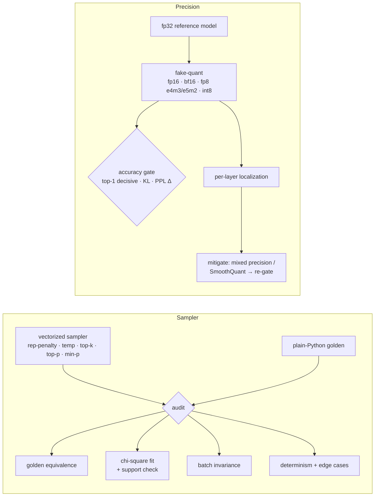

# sampling-precision-validation

A validation harness for two places where LLM inference goes quietly wrong while the service still returns 200s: the **token sampler** and **low-precision inference**. A bad sampler shifts the output distribution. A bad quantization recipe costs accuracy that no latency dashboard shows. Both need statistical, reference-based tests rather than example-based ones.

This repo is written from the SDET side: it validates samplers and quantized models, and it doesn't claim kernel work.



## Sampler audit

Five named checks decide whether a sampler build is correct. Each of the four seeded defects is a bug class that has shown up in real sampler code, and the suite proves it catches every one (`test_audit_catches_seeded_bug`):

| Build | Caught by |
|---|---|
| correct | passes all 5 checks |
| `topp_boundary`: keeps `cumsum < p`, which drops the token that crosses p, so a confident top token empties the set and gives NaN | golden equivalence, chi-square fit, edge cases |
| `rep_penalty_sign`: divides negative logits by the penalty, which makes repeated tokens *more* likely | golden equivalence, edge cases |
| `shared_rng`: one RNG per batch, so a request's token depends on its neighbours | batch invariance (only this check can see it) |
| `temp_after_topp`: temperature applied after the nucleus is chosen | golden equivalence |

- **Statistics with fixed seeds:** 20k draws per case are chi-square tested against the golden distribution, plus a hard support check (never draw a zero-probability token). The seeds are fixed, so a statistical check never flakes in CI.
- **Fast path = slow path:** the vectorized sampler is fuzzed against a plain-Python golden that shares no code with it (200 random configs, |Δp| ≤ 1e-9). top-k uses an O(V) `partition` instead of a full sort, and the same golden proves it's still exact.

## Low-precision accuracy gate

Fake quantization rounds values onto each format's real grid: round-to-nearest-even, subnormals, saturation. bf16 is bit-exact against IEEE bit-level rounding, and E4M3 has exactly 127 non-negative values. A 6-layer model is compared with its fp32 self on 2,048 held-out positions (`python -m spv report`):

| Config | Top-1 (decisive) | KL (nats) | PPL Δ | Gate |
|---|---|---|---|---|
| fp16 | 1.0000 | 5.9e-07 | -0.00% | ✅ |
| bf16 | 1.0000 | 3.9e-05 | +0.00% | ✅ |
| FP8 E4M3, per-tensor activations | 0.9946 | 9.0e-03 | +1.04% | ✅ |
| FP8 E5M2, per-tensor activations | 0.9605 | 3.6e-02 | +3.11% | ❌ 2-bit mantissa too coarse for inference |
| INT8, per-tensor activations | 0.9605 | 3.5e-02 | +3.14% | ❌ |
| INT8 + layer 3 kept in bf16 | 1.0000 | 1.3e-03 | +0.13% | ✅ |
| INT8 + SmoothQuant (α 0.5) | 1.0000 | 1.4e-03 | +0.16% | ✅ |

**Which layer broke?** Quantizing one layer at a time attributes **96% of the INT8 error to layer 3**, the layer built with LLM-style activation outliers (3 channels ~50× hotter, which set the per-tensor scale and crush every other channel). Two standard mitigations, keeping that layer in bf16 or SmoothQuant (moving outlier magnitude into per-channel-quantized weights), both pass the gate.

The format finding is pinned by `test_fp8_e4m3_is_not_dominated_by_the_outlier_layer`: FP8 E4M3's exponent absorbs the same outliers that break per-tensor INT8.

**Signal vs noise in the gate:** top-1 agreement is measured only on *decisive* positions, where fp32 top-1 beats top-2 by ≥ 0.05. Raw agreement on near-tie positions flips on any rounding noise (E4M3 raw agreement is 0.89, decisive is 0.995), which would make the gate flaky without catching anything real. Raw agreement is still reported.

## Run it

```bash
python3 -m venv .venv && .venv/bin/pip install -r requirements.txt
.venv/bin/python -m pytest                      # 34 tests, ~10s
.venv/bin/python -m spv audit                   # correct sampler: all checks pass
.venv/bin/python -m spv audit --bug shared_rng  # exit 1: batch invariance fails
.venv/bin/python -m spv precision --fmt int8    # gate fails + per-layer table names layer 3
.venv/bin/python -m spv precision --fmt int8 --keep-high 3
.venv/bin/python -m spv report --out reports    # full matrix; CI job summary
```

CI runs the tests, then `spv report`, which fails if any expectation flips (a seeded bug goes uncaught, a gate outcome changes, or localization names the wrong layer). The report is posted to the job summary.

## Layout

```
spv/sampler.py    vectorized sampler + 4 seedable defects
spv/reference.py  plain-Python golden (no shared code)
spv/audit.py      5 named checks (golden, chi-square, batch invariance, determinism, edge cases)
spv/formats.py    fp16 / bf16 / fp8 e4m3 / e5m2 / int8 fake quantization on exact grids
spv/model.py      6-layer next-token model with a planted activation-outlier layer
spv/precision.py  metrics, gates, per-layer localization
gates.json        per-format thresholds
docs/             STRATEGY.md: which signals gate a release, and why
```

## Where this stops

- Fake quantization measures **accuracy**, not speed. Real FP8 / INT8 kernels add accumulation-order and fused-epilogue effects that this emulation doesn't model; the same gate should run against real kernel outputs once they exist.
- The model is a 6-layer toy whose outliers are planted. On a production LLM, the gate's metrics apply unchanged, but thresholds need calibrating on real eval sets, plus task-level evals (not just next-token agreement).
- The sampler is a numpy reference with batch-shared params. Production samplers (GPU, per-request params, speculative decoding) need the same audit pointed at their outputs; the golden and the checks are the reusable part.
- `spv bench` reports numpy throughput for regression tracking only. It's not a kernel benchmark.
